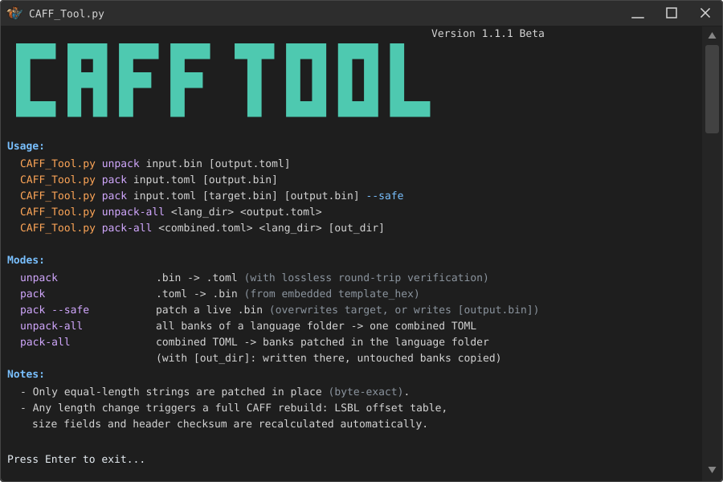

<p align>
  
</p>

---

[badge-en]: https://img.shields.io/badge/lang-English%20%F0%9F%87%AC%F0%9F%87%A7-white
[badge-ru]: https://img.shields.io/badge/%D1%8F%D0%B7%D1%8B%D0%BA-%D0%A0%D1%83%D1%81%D1%81%D0%BA%D0%B8%D0%B9%20%F0%9F%87%B7%F0%9F%87%BA-white
[vot-readme-en]: README.md
[vot-readme-ru]: README_RU.md
[![en][badge-en]][vot-readme-en]
[![ru][badge-ru]][vot-readme-ru]

An editor for **Conker: Live & Reloaded** (Xbox, 2005) CAFF text banks (`.bin`):
unpacks them into editable TOML and repacks with support for strings of **any length**.

> Based on the CAFF format analysis from the **[conker-live-and-reloaded-decensor](https://github.com/nastys/conker-live-and-reloaded-decensor)** project.
> The original repository contains a full toolset (decensor and more); this
> repository focuses solely on `caff_tool`, with accurate structural parsing,
> correct key binding, UI layout grouping and rebuild support for longer strings.

## Features

- **Accurate unpacking**: strings and keys are extracted structurally (key table +
  LSBL offset table), not heuristically. Round-trip verified byte-for-byte on all
  467 game `.bin` files (EN/FR/DE/ES/IT/JA).
- **Correct key binding**: a key is linked to its string via the source-script line
  number (`key.X high 16 bits` = `line` field of the LSBL entry). UI labels no
  longer end up attached to the wrong keys.
- **UI layout in a single record**: `KEY|KEY_POSITION_X|KEY_POSITION_Y|KEY_SCALE`:

  ```toml
  [[entries]]
  key = "GAME_1|GAME_1_POSITION_X|GAME_1_POSITION_Y|GAME_1_SCALE"
  position_x = "0"
  position_y = "0"
  scale = "0"
  text = "Game 1"
  ```

- **Readable UTF-8**: texts in any language stay literal in TOML, no `\u` escapes.
- **Length changes**: equal-length strings are patched byte-for-byte; any length
  change (shorter or longer) triggers a full CAFF rebuild — the LSBL #1 offset table, size fields (`0x34`,
  `0x50`, `0x64`, `0x194`, `B`/`C`) and the header checksum (`0x14`) are
  recalculated automatically.
- `offset`/`max_bytes` fields are not needed in TOML — packing resolves strings by
  key names (older TOMLs that include these fields are still supported).

## Requirements

Python **3.11+** (uses the standard `tomllib`). No dependencies.

## Usage

> ⚠️ On Windows, you can use either `python` or `py` to run the script, depending on your Python installation.

> ⚠️ On Linux you may need to use `python3` instead of `python`.

```bat
:: .bin -> .toml (with built-in lossless round-trip verification)
python caff_tool.py unpack input.bin [output.toml]

:: .toml -> .bin
python caff_tool.py pack input.toml [output.bin]

:: patch a live .bin (overwrites it!)
python caff_tool.py pack input.toml [target.bin] [output.bin] --safe
```

Batch mode (recursively converts all `default.bin` ↔ `default.toml`):
- Windows: `caff_unpack.bat <folder>` / `caff_pack.bat <folder>`
- Linux/macOS: `bash caff_unpack.sh <folder>` / `bash caff_pack.sh <folder>`

## TOML format

```toml
[meta]
build_path = 'D:\Database\UberRoot\aid\text\English\UIFrontend\XBOX_v1\default.bin'

[script]
audio_meta = "; ..."

[[entries]]
key = "CHAPTERS|CHAPTERS_POSITION_X|CHAPTERS_POSITION_Y|CHAPTERS_SCALE"
position_x = "0"
position_y = "0"
scale = "0"
text = "Chapters"

[binary]
template_hex = "43414646..."   # reference binary (pack fallback)
```

Only the `text` values (and `position_*`, if you need to adjust the layout)
are meant to be edited. The composite `key` is a single record identifier,
`|` is the separator.

## Translation guidelines

1. Do not remove engine control tags: `{PMARKER}`, `{SWIRL}`, `{STAR}`,
   `{LIGHTNING}`, `{SKULL}` — they control subtitle pauses and icons.
2. Do not "translate" `position_x` / `position_y` / `scale` — these are menu
   element coordinates/scale (`"0"` = default).
3. Do not rename keys (`key`): packing resolves strings by them; a typo raises
   `Key '...' not found in binary`.
4. String length is technically unlimited, but subtitle display time is fixed
   (bound to the voice-over timing) and does not depend on text length: a longer
   line will not be shown any longer and may simply be unreadable in time. Try to
   stay within a reasonable length of the original.

## CAFF structure (overview)

```
0x000  CAFF header (0x180 bytes, checksum @ 0x14)
0x180  "text" section, magic 0x3E2EA091
0x1A8  count
0x1AC  key table: count × (key_off, X); X.high16 = source-script line number
       UTF-16LE key names
LSBL   "LSBL": (u16 line, u32 wchar_offset)+ table — string offsets;
       line == key.X.high16 links a key to its string
texts  UTF-16LE, NUL-terminated
tail   LSBL #2 (ASCII keys), debug comments, build_path
```

When a text grows, the file tail shifts — hence the rebuild: recalculating
LSBL #1, section sizes and the checksum.

## Credits

- Font: [Fira Code](https://github.com/tonsky/FiraCode) by Nikita Prokopov,
  licensed under the [SIL Open Font License 1.1](https://openfontlicense.org
  )

---

Not affiliated with Microsoft / Rare. All trademarks are property of their
respective owners. Intended for non-commercial use (translations, modding,
format research).
