# CAFF Tool

[badge-en]: https://img.shields.io/badge/lang-English%20%F0%9F%87%AC%F0%9F%87%A7-white
[badge-ru]: https://img.shields.io/badge/%D1%8F%D0%B7%D1%8B%D0%BA-%D0%A0%D1%83%D1%81%D1%81%D0%BA%D0%B8%D0%B9%20%F0%9F%87%B7%F0%9F%87%BA-white
[vot-readme-en]: README.md
[vot-readme-ru]: README_RU.md
[![en][badge-en]][vot-readme-en]
[![ru][badge-ru]][vot-readme-ru]

Редактор текстовых банков CAFF (`.bin`) для **Conker: Live & Reloaded** (Xbox, 2005): распаковка в редактируемый TOML и обратная сборка с поддержкой строк **любой длины**.

> Основано на разборе формата из проекта **[conker-live-and-reloaded-decensor](https://github.com/nastys/conker-live-and-reloaded-decensor)**.
> В оригинальном репозитории — набор инструментов (decensor и др.), здесь же собран
> и доработан только `caff_tool`: точный структурный разбор, корректная привязка
> ключей, группировка параметров расположения элементов интерфейса и пересборка при изменении длины строк.

## Возможности

- **Точная распаковка**: строки и ключи извлекаются структурно (таблица ключей + таблица смещений LSBL), а не эвристическими методами. Побайтовое совпадение после распаковки и обратной сборки подтверждено для всех 467 игровых файлов `.bin` (EN/FR/DE/ES/IT/JA).
- **Корректная привязка ключей**: ключ связан со строкой через номер строки исходного скрипта (`X.high16` ключа = `line` записи LSBL). Подписи элементов интерфейса больше не связываются с неправильными ключами.
- **UI-раскладка в одной записи**: `KEY|KEY_POSITION_X|KEY_POSITION_Y|KEY_SCALE`:

  ```toml
  [[entries]]
  key = "GAME_1|GAME_1_POSITION_X|GAME_1_POSITION_Y|GAME_1_SCALE"
  position_x = "0"
  position_y = "0"
  scale = "0"
  text = "Game 1"
  ```

- **Читаемый UTF-8**: тексты на любом языке сохраняются в TOML без экранирования символов последовательностями `\uXXXX`.
- **Изменение длины строк**: строки прежней длины заменяются побайтно; любое изменение длины (в меньшую или большую сторону) запускает полную пересборку CAFF — таблица смещений LSBL №1, поля размеров (`0x34`, `0x50`, `0x64`, `0x194`, `B`/`C`) и контрольная сумма заголовка (`0x14`) пересчитываются автоматически.
- Поля `offset`/`max_bytes` в TOML не нужны — при сборке строки определяются по именам ключей (старые TOML с этими полями поддерживаются).

## Визуализация CLI

<p align>
  
</p>

<p align>
  
</p>

## Требования

Python **3.11+** (используется стандартный `tomllib`). Зависимостей нет.

## Использование

> ⚠️ В Windows для запуска можно использовать `python` или `py`, в зависимости от установленной версии Python.

> ⚠️ В Linux вместо `python` может потребоваться использовать `python3`.

```bat
:: .bin → .toml (с проверкой побайтового совпадения после обратной сборки)
python caff_tool.py unpack <входной_файл.bin> [выходной_файл.toml]

:: .toml → .bin
python caff_tool.py pack <входной_файл.toml> [выходной_файл.bin]

:: внесение изменений в существующий .bin (--safe использует целевой файл как источник)
python caff_tool.py pack <входной_файл.toml> [целевой_файл.bin] [выходной_файл.bin] --safe

:: распаковка всех банков в один TOML-файл и обратно
python caff_tool.py unpack-all <папка_языка> <выходной_файл.toml>
python caff_tool.py pack-all <общий_файл.toml> <папка_языка> [выходная_папка]
```

Пакетная обработка папки: рекурсивное преобразование файлов `default.bin` ↔ `default.toml`.
- Windows: `caff_unpack.bat <папка>` / `caff_pack.bat <папка>`
- Linux/macOS: `bash caff_unpack.sh <папка>` / `bash caff_pack.sh <папка>`

## Формат TOML

```toml
[meta]
build_path = 'D:\Database\UberRoot\aid\text\English\UIFrontend\XBOX_v1\default.bin'

[script]
audio_meta = "; ..."

[[entries]]
key = "CHAPTERS|CHAPTERS_POSITION_X|CHAPTERS_POSITION_Y|CHAPTERS_SCALE"
position_x = "0"
position_y = "0"
scale = "0"
text = "Chapters"

[binary]
template_hex = "43414646..."   # эталонный бинарный файл (резервный источник данных при сборке)
```

Редактируются только значения `text` (и `position_*`, если нужно сдвинуть раскладку). Составной `key` — единый идентификатор записи, разделитель `|`.

## Правила перевода

1. Не удалять управляющие теги движка: `{PMARKER}`, `{SWIRL}`, `{STAR}`, `{LIGHTNING}`, `{SKULL}` — они управляют паузами и иконками субтитров.
2. `position_x` / `position_y` / `scale` не переводить — это координаты/масштаб элементов меню (`"0"` = по умолчанию).
3. Ключи (`key`) не переименовывать: сборка находит строки по ним; опечатка выдаст ошибку `Key '...' not found in binary`.
4. Длина строки технически не ограничена, но время показа субтитра фиксировано (привязано к таймингам озвучки) и от длины текста не зависит. Старайтесь укладываться в разумную длину оригинала.

## Структура CAFF (кратко)

```
0x000  заголовок CAFF (0x180 байт, контрольная сумма @ 0x14)
0x180  секция "text", магия 0x3E2EA091
0x1A8  count
0x1AC  таблица ключей: count × (key_off, X); X.high16 = номер строки скрипта
       ключи UTF-16LE
LSBL   "LSBL": таблица (u16 line, u32 wchar_offset)+ — смещения строк;
       line == X.high16 ключа связывает ключ со строкой
тексты UTF-16LE, NUL-терминированы
хвост  LSBL №2 (ASCII-ключи), отладочные комментарии, build_path
```

При удлинении текста сдвигается хвост файла — поэтому и нужен rebuild: пересчёт таблицы смещений LSBL №1, размеров секций и контрольной суммы.

---

Проект не связан с Microsoft или Rare. Все товарные знаки принадлежат их правообладателям. Инструмент предназначен для некоммерческого использования (переводы, моддинг, исследование форматов).
